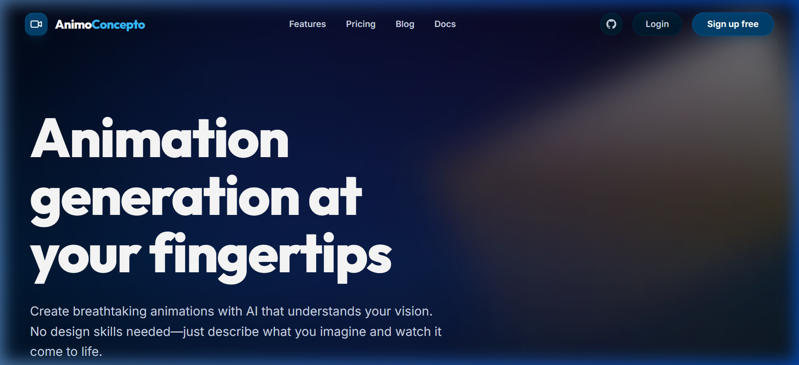
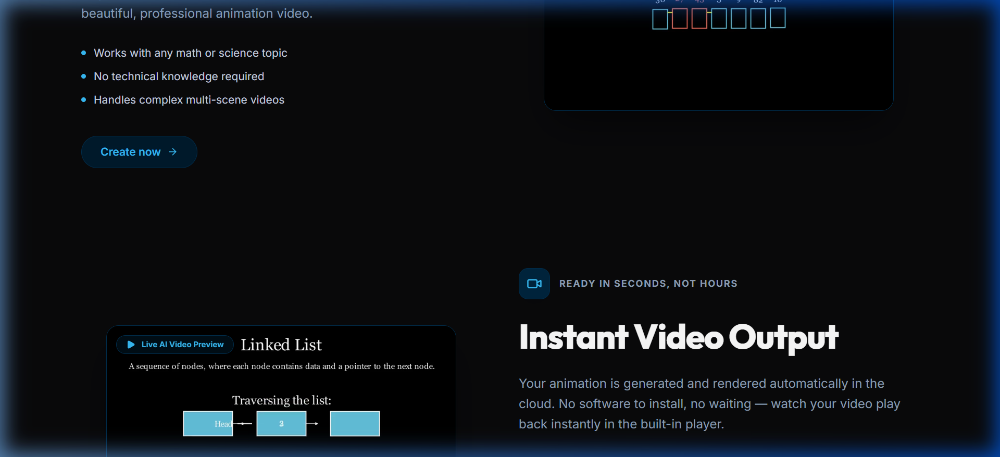
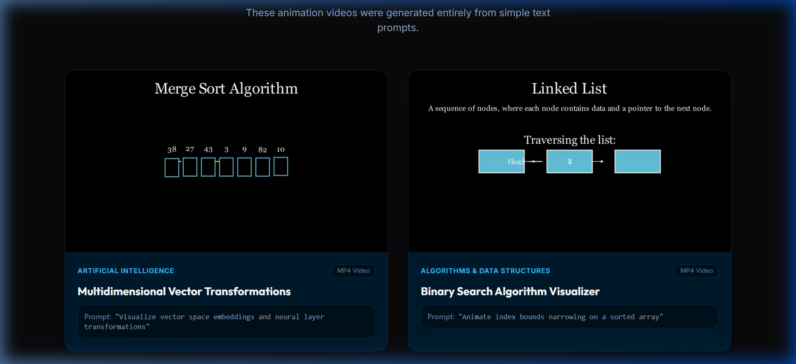
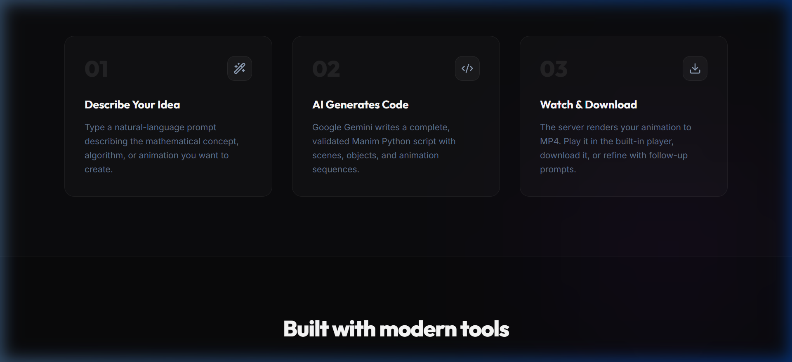
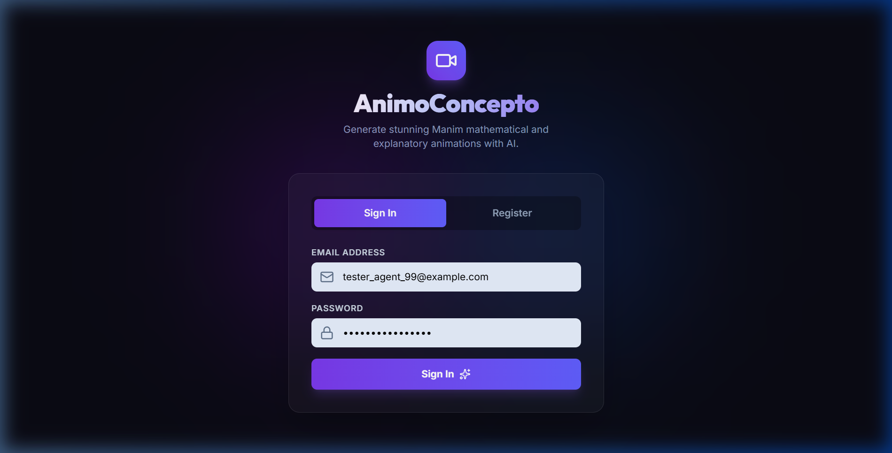
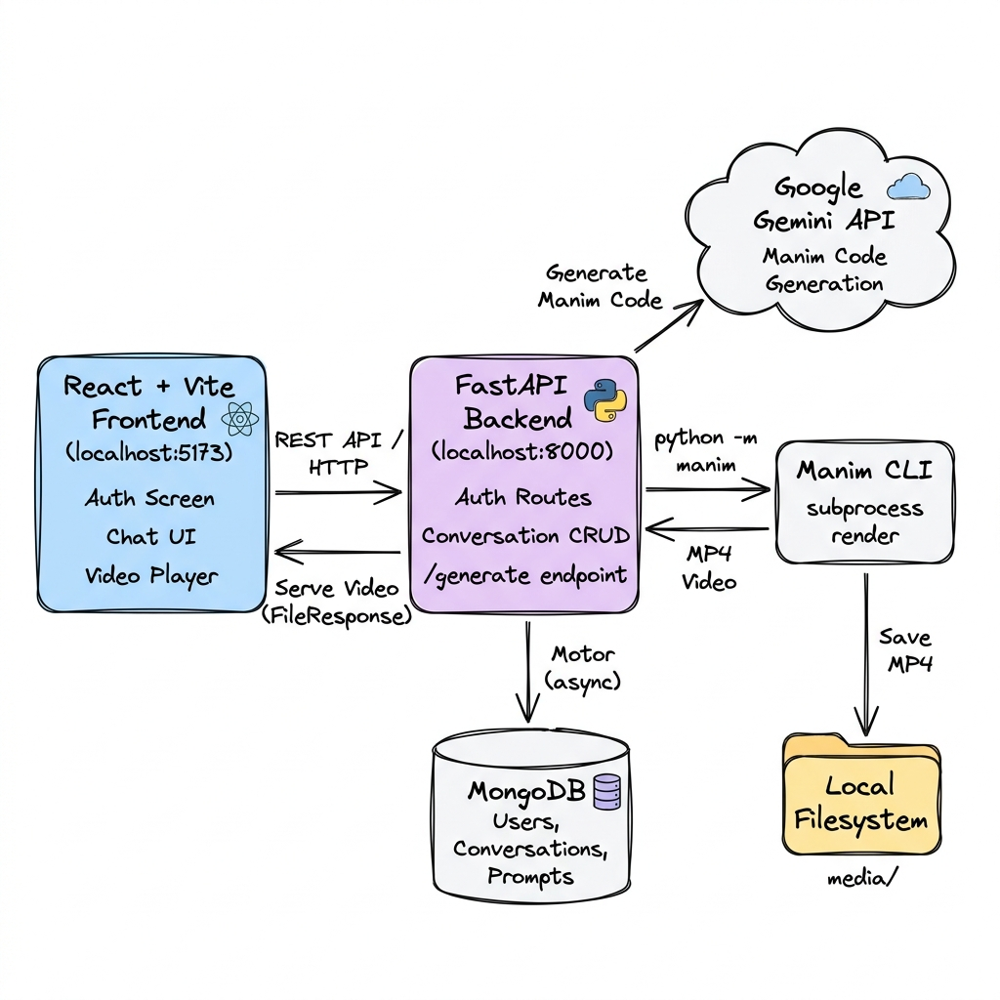
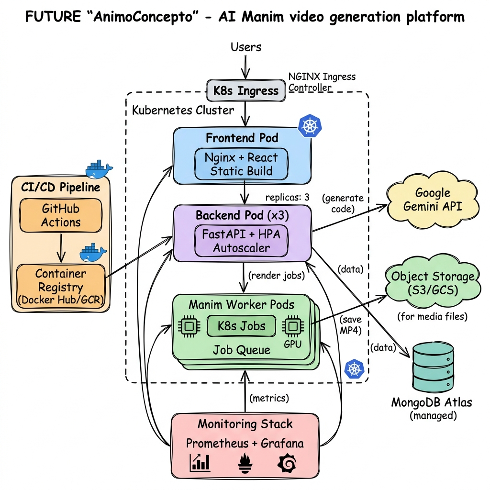

<div align="center">

# 🎬 AnimoConcepto

### AI-Powered Mathematical Animation Generator

[](https://fastapi.tiangolo.com/)
[](https://react.dev/)
[](https://www.manim.community/)
[](https://ai.google.dev/)
[](https://www.mongodb.com/)
[](https://vite.dev/)
[](https://tailwindcss.com/)
[](LICENSE)

**Describe any mathematical concept in plain English. AnimoConcepto uses Google Gemini to generate Manim code and renders stunning explanatory animation videos — all through a conversational chat interface.**

[Get Started](#-quick-start) · [Features](#-features) · [Architecture](#-system-architecture) · [Screenshots](#-screenshots) · [API Reference](#-api-endpoints) · [Roadmap](#-future-architecture--roadmap)

</div>

---

## 📸 Screenshots

<div align="center">

### Landing Page


### Feature Highlights with Live Videos


### Real AI Video Showcase Gallery


### How It Works


### Authentication


</div>

---

## ✨ Features

| Feature | Description |
|---------|-------------|
| 🧠 **AI Code Generation** | Google Gemini writes production-ready Manim Python code from natural language prompts |
| 🎬 **Instant Video Rendering** | Server-side Manim compilation with automatic MP4 output |
| 💬 **Conversational Workflow** | Chat-based interface to iterate and refine animations |
| 🔍 **Code Transparency** | Full visibility into generated Manim scripts |
| ▶️ **Custom Video Player** | Built-in player with seek, volume, fullscreen, and download |
| ⚡ **Quick Templates** | Pre-built prompts for LLMs, Fourier series, binary search, linear algebra |
| 🔐 **JWT Authentication** | Secure user registration and login with token-based auth |
| 📂 **Conversation History** | Persistent conversations stored in MongoDB with full CRUD |

---

## 🏗️ System Architecture

### Current Architecture

The current system runs as a monolithic local deployment with the following components:

<div align="center">

</div>

**Data Flow:**
```
User → React Frontend (Vite) → FastAPI Backend → Google Gemini API
                                     ↓
                              Manim CLI (subprocess)
                                     ↓
                              MP4 Video → Local Filesystem
                                     ↓
                              Served back via FileResponse
```

| Component | Technology | Role |
|-----------|-----------|------|
| **Frontend** | React 19 + Vite + TailwindCSS 4 | SPA with Auth, Chat UI, Video Player |
| **Backend** | FastAPI + Uvicorn | REST API, Auth, Generation orchestration |
| **AI Engine** | Google Gemini (via `google-generativeai`) | Generates Manim Python code from prompts |
| **Renderer** | Manim Community Edition | Compiles Python scenes into MP4 videos |
| **Database** | MongoDB (via Motor async driver) | Users, conversations, prompts storage |
| **Storage** | Local filesystem (`media/`) | Rendered video file storage |

---

### 🚀 Future Architecture & Roadmap

The planned production architecture migrates to Docker containers deployed on Kubernetes:

<div align="center">

</div>

**Planned Improvements:**

- [ ] **Containerization** — Dockerize frontend (Nginx) and backend (FastAPI) services
- [ ] **Kubernetes Deployment** — Deploy on K8s with Deployments, Services, and Ingress
- [ ] **Worker Pool** — Run Manim renders as Kubernetes Jobs or a dedicated worker pool with GPU support
- [ ] **Object Storage** — Migrate media storage from local filesystem to S3/GCS
- [ ] **Managed Database** — Move to MongoDB Atlas for production reliability
- [ ] **CI/CD Pipeline** — GitHub Actions → Container Registry → K8s rolling deployments
- [ ] **Monitoring** — Prometheus + Grafana for observability and alerting
- [ ] **Autoscaling** — HPA for backend pods based on CPU/request metrics

---

## 🚀 Quick Start

### Prerequisites

- **Python** 3.10, 3.11, or 3.12 (system Python recommended)
- **Node.js** 18+ and npm
- **MongoDB** instance (local or Atlas)
- **Manim** Community Edition with system dependencies ([installation guide](https://docs.manim.community/en/stable/installation.html))
- **Google Gemini API Key** ([get one here](https://ai.google.dev/))

### 1. Clone the Repository

```bash
git clone https://github.com/Priyesh1311421/AnimoConcepto.git
cd AnimoConcepto
```

### 2. Backend Setup

```bash
cd backend

# Create and activate virtual environment
python -m venv .venv
# Windows
.\.venv\Scripts\Activate.ps1
# macOS/Linux
source .venv/bin/activate

# Install dependencies
pip install -r requirements.txt
```

Create a `.env` file in the `backend/` directory:

```env
MONGO_URL=mongodb://localhost:27017
GEMINI_API_KEY=your_gemini_api_key_here
GEMINI_MODEL=gemini-2.0-flash
```

Start the backend server:

```bash
uvicorn app:app --host 0.0.0.0 --port 8000
```

### 3. Frontend Setup

```bash
cd frontend

# Install dependencies
npm install
```

Create a `.env` file in the `frontend/` directory (optional):

```env
VITE_API_BASE_URL=http://localhost:8000
```

Start the development server:

```bash
npm run dev
```

### 4. Open the App

Visit **[http://localhost:5173](http://localhost:5173)** in your browser!

---

## 🔌 API Endpoints

### Authentication

| Method | Endpoint | Description |
|--------|----------|-------------|
| `POST` | `/register?email=...&password=...` | Register a new user |
| `POST` | `/login?email=...&password=...` | Login and receive JWT token |

### Conversations

| Method | Endpoint | Description |
|--------|----------|-------------|
| `POST` | `/conversations` | Create a new conversation |
| `GET` | `/conversations` | List all conversations for the user |
| `DELETE` | `/conversations/{id}` | Delete a conversation and its prompts |
| `GET` | `/conversations/{id}/prompts` | Get all prompts in a conversation |

### Generation

| Method | Endpoint | Description |
|--------|----------|-------------|
| `POST` | `/generate` | Generate Manim video from a prompt |
| `GET` | `/video/{prompt_id}` | Stream the rendered MP4 video |

> **Note:** All endpoints except `/register` and `/login` require a `Bearer` token in the `Authorization` header.

---

## 🛠️ Tech Stack

<div align="center">

| Layer | Technology | Version |
|-------|-----------|---------|
| **Frontend** | React | 19.2 |
| **Build Tool** | Vite | 8.0 |
| **Styling** | TailwindCSS | 4.3 |
| **Animations** | Framer Motion | 12.x |
| **Icons** | Lucide React | 1.17 |
| **Backend** | FastAPI | Latest |
| **Database** | MongoDB (Motor) | Latest |
| **AI Model** | Google Gemini | 2.0 Flash |
| **Renderer** | Manim CE | Latest |
| **Language** | TypeScript / Python | 6.0 / 3.12 |

</div>

---

## 📁 Project Structure

```
AnimoConcepto/
├── backend/
│   ├── app.py                  # FastAPI application with all routes
│   ├── auth.py                 # Password hashing, JWT token utils
│   ├── openrouter_wrapper.py   # Gemini AI code generation wrapper
│   ├── requirements.txt        # Python dependencies
│   ├── .env                    # Environment variables (not committed)
│   ├── scenes/                 # Generated Manim scene scripts
│   └── media/                  # Rendered MP4 video output
│
├── frontend/
│   ├── index.html              # HTML entry point
│   ├── vite.config.ts          # Vite + TailwindCSS + React config
│   ├── package.json            # Node dependencies
│   └── src/
│       ├── main.tsx            # React entry point
│       ├── App.tsx             # Root component with auth/routing logic
│       ├── index.css           # Global styles + brand tokens
│       ├── App.css             # Legacy component styles
│       ├── utils/
│       │   └── api.ts          # API client with auth token management
│       └── components/
│           ├── LandingPage.tsx      # Public landing page with hero + features
│           ├── AuthScreen.tsx       # Login / Register glassmorphic form
│           ├── Sidebar.tsx          # Conversation list sidebar
│           ├── ChatArea.tsx         # Main chat interface
│           ├── QuickTemplates.tsx   # Starter prompt template cards
│           ├── CustomVideoPlayer.tsx # Full-featured video player
│           ├── CodeViewer.tsx       # Generated code display
│           └── SkeletonLoader.tsx   # Loading skeleton placeholder
│
├── docs/
│   ├── current_architecture.png    # Current system architecture diagram
│   ├── future_architecture.png     # Future K8s architecture diagram
│   └── screenshots/                # Application screenshots
│       ├── landing_hero.png
│       ├── landing_features.png
│       ├── landing_how_it_works.png
│       ├── auth_screen.png
│       ├── features_grid.png
│       └── landing_footer.png
│
└── README.md
```

---

## 📝 Environment Variables

### Backend (`backend/.env`)

| Variable | Required | Description |
|----------|----------|-------------|
| `MONGO_URL` | ✅ | MongoDB connection string |
| `GEMINI_API_KEY` | ✅ | Google Gemini API key |
| `GEMINI_MODEL` | ❌ | Model name (default: `gemini-2.0-flash`) |

### Frontend (`frontend/.env`)

| Variable | Required | Description |
|----------|----------|-------------|
| `VITE_API_BASE_URL` | ❌ | Backend URL (default: `http://localhost:8000`) |

---

## 🤝 Contributing

1. Fork the repository
2. Create a feature branch (`git checkout -b feature/amazing-feature`)
3. Commit your changes (`git commit -m 'Add amazing feature'`)
4. Push to the branch (`git push origin feature/amazing-feature`)
5. Open a Pull Request

---

## 📄 License

This project is open source and available under the [MIT License](LICENSE).

---

<div align="center">

**Built with ❤️ by [Priyesh](https://github.com/Priyesh1311421)**

*AnimoConcepto — Turning ideas into stunning mathematical animations with AI.*

</div>
